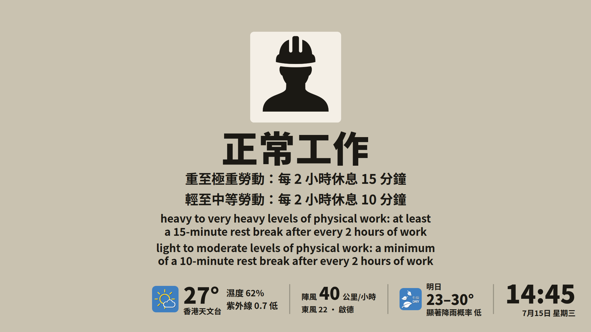
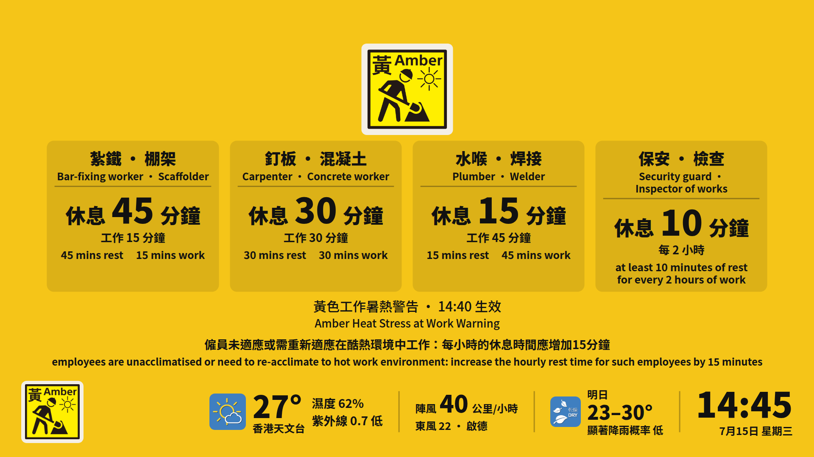
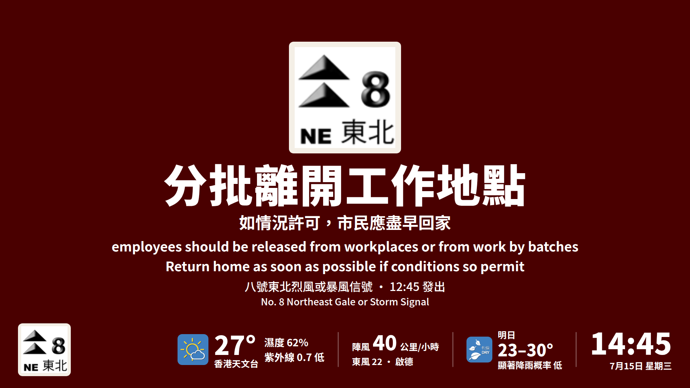
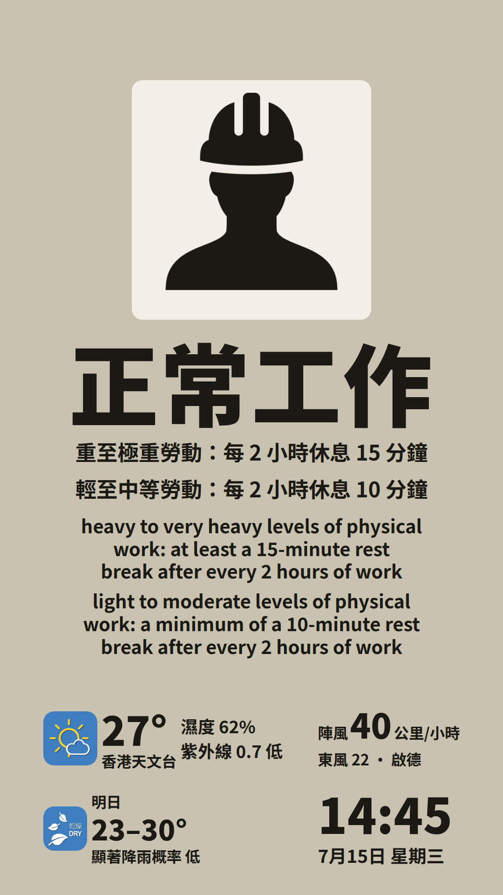
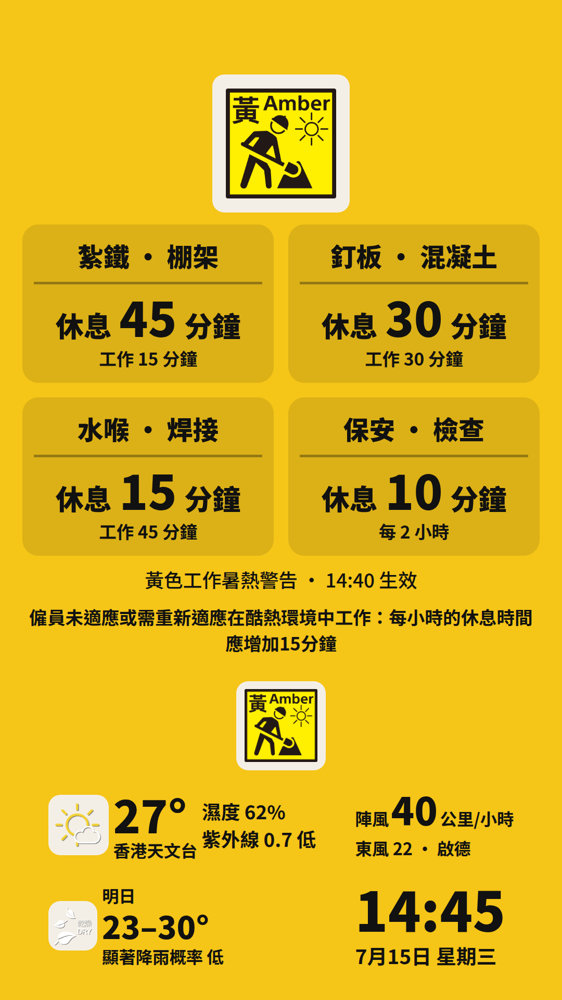
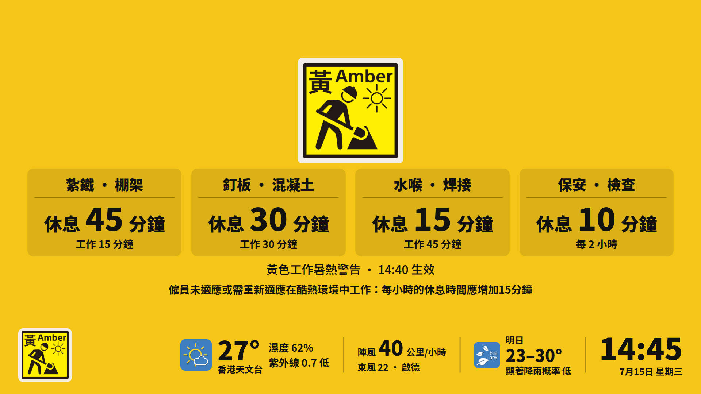

# hk-site-display

Hong Kong construction **site notice**: live Labour Department Heat Stress at Work Warning (HSWW) and HKO weather warnings on one screen at the gate.

Official HKO / Labour Department icons and wording only. Every state uses one centred layout, in landscape or portrait: a large official icon, the instruction, and a bottom bar with every warning in force, the temperature and the wind at the nearest HKO stations, tomorrow's forecast with its chance of significant rain, and the clock. On heat-stress days the instruction becomes one tile per rest time, labelled with the site's trades. A site can add an English line under the Chinese, made only of the official English versions of the same sentences. One server runs many sites, and each screen runs unattended. Not a 4S system. Not a sensor product.

## Live demo

| | |
|---|---|
| Live | https://hksite-display.loadingtechnology.app/ |
| Preview (switch cases; does not overlay live) | https://hksite-display.loadingtechnology.app/?preview=1 |
| Gallery (every official icon + case) | https://hksite-display.loadingtechnology.app/?gallery=1 |

The demo site shows the official English line (`"languages": ["zh", "en"]`):







Same URL, portrait:





A site without `languages` shows Chinese only, exactly as before:



Design and decisions: `docs/superpowers/specs/` ([gate screen](docs/superpowers/specs/2026-10-06-gate-screen-upgrade-design.md), [weather station by location](docs/superpowers/specs/2026-10-06-weather-station-by-location-design.md), [site-ready upgrade](docs/superpowers/specs/2026-11-07-site-ready-upgrade-design.md), [official English line](docs/superpowers/specs/2026-11-07-english-line-design.md)). Installing a screen: [docs/site-setup.md](docs/site-setup.md).

## Rules the notice will not break

- HSWW level comes only from `hkhi_icon.xml` `iconIndex` (30 amber / 32 red / 34 black). Never inferred from HKHI CSV or the title string.
- Rest minutes live in `config/rest_schedule.json` only (LD guidance Appendix 4; the indoor −15 minute adjustment reproduces Appendix 4(a)).
- Instruction text lives in `config/display_actions.json`, stored with the official sentence it comes from. `tests/test_display_actions.py` fails if a displayed fragment is not a verbatim part of its quote.
- English follows the same rule: each English line is a verbatim part of the official English version of the sentence, quoted from LD's or HKO's English document next to the Chinese, under the same test. Where no official English sentence exists, the screen shows no English. Nothing is translated, and Chinese stays the main text.
- Warning marks are official HKO/LD files. We do not draw substitute typhoon / rain / heat symbols.
- Wind is HKO's reading at a named station, nothing more. The screen never turns it into a limit or an instruction: lifting limits are the crane's or gondola's own.
- `GET /api/v1/snapshot` is always live. `POST /sim` is preview-only.

## Official sources (checked 2026-10-06; English 2026-11-07)

- Labour Department 《預防工作時中暑指引》, 3rd edition (revised) Aug 2026: https://www.labour.gov.hk/common/public/oh/Heat_Stress_GN_tc.pdf
- Labour Department 《惡劣天氣及「極端情況」下的工作守則》, May 2026: https://www.labour.gov.hk/tc/public/pdf/wcp/Rainstorm.pdf
- HKO advice pages for tropical cyclone signals, rainstorms, landslips and tsunamis (URLs in `config/display_actions.json`)
- The English versions, for the English line: LD *Guidance Notes on Prevention of Heat Stroke at Work*, Third edition (Revised) August 2026 (https://www.labour.gov.hk/common/public/oh/Heat_Stress_GN_en.pdf), LD *Code of Practice in Times of Adverse Weather and "Extreme Conditions"*, May 2026 (https://www.labour.gov.hk/eng/public/wcp/Rainstorm.pdf), and HKO's English advice pages
- HKO Open Data API documentation: https://data.weather.gov.hk/weatherAPI/doc/HKO_Open_Data_API_Documentation.pdf

Re-check every April and whenever LD or HKO announce a revision (spec §9).

**Weekly official-source check.** Every Monday at 09:00 HKT, and on demand from the Actions tab, `.github/workflows/official-sources.yml` runs `python scripts/check_official_sources.py`. It downloads every source in `config/display_actions.json` again and fails if any quoted sentence is no longer in it word for word. It also fails if a Labour Department PDF differs from the version recorded in `config/official_sources_lock.json`, because the rest tables are not quotes and need a person to compare them. Then it runs `scripts/fetch_hko_stations.py --check`.

When a PDF changes:

1. Re-verify it (spec §9) and update `sources.<key>.checked`.
2. Run `python3 scripts/check_official_sources.py --update-lock`. It needs `pip install "pypdf[crypto]" fonttools`.
3. Commit the lock.

GitHub notifies whoever last changed the schedule when a scheduled run fails. In a public repository, GitHub disables the schedule after 60 days without activity.

## Data sources

| Feed | Source | Refresh |
|---|---|---|
| HSWW | `https://www.hko.gov.hk/wxinfo/hkhi/hkhi_icon.xml` | 60 s |
| Warnings | HKO Open Data `warnsum` + `warningInfo` | 60 s |
| English warning names, for the English line | HKO Open Data `warnsum` with `lang=en`. Names only: it never decides what is in force | 60 s |
| Current weather | HKO Open Data `rhrread` | 10 min |
| 9-day forecast, with each day's chance of significant rain (`PSR`) | HKO Open Data `fnd` | 30 min |
| 10-minute wind and gust | HKO `latest_10min_wind_uc.csv` (regional weather) | 5 min |

Each feed is cached separately, and a failing feed keeps its last value.
- The screen shows 資料過期 when the warning feeds are more than 10 minutes old.
- It hides the weather after 90 minutes, the wind after 30 minutes and the forecast after 12 hours.
- The notice refreshes `/api/v1/snapshot` every 30 s.

When the warning icons need the room on a landscape bar, the bar hides humidity and UV first, then tomorrow, then the wind. It never hides the warnings or the clock. In portrait the bar becomes two rows. If the centre content is too tall, it shrinks as a whole rather than lose a line of official wording. On a site that shows English, English lines are given up, least useful first, only when the centre would not fit even at its smallest size. The Chinese always keeps its room.

Icons: `apps/kiosk/public/official/` (see its README). Refresh them with `python3 scripts/fetch_official_icons.py`.

## Weather and wind stations, and location

The temperature and the wind on the bottom bar each come from an HKO station, and the station's name is shown with them.

- The page asks the browser for the screen's location. If it is allowed, the screen shows the nearest HKO station that is reporting a temperature, and the nearest ground-level wind station that is reporting a wind speed.
- With no location (refused, unavailable, too coarse to be useful, outside Hong Kong, or the page is plain `http://`, since browsers only allow location on `https://` and `localhost`), the temperature is 香港天文台, the general HKO reading, and the wind is the site's `windStation`. A site can name another temperature fallback with `weatherStation`. Without a `windStation`, there is no wind block.
- The hill-top wind stations, 昂坪 (593 m) and 大老山 (572 m), are never chosen as nearest. A site on high ground names one as its `windStation` and uses `?loc=0`.
- The screen never waits for the browser's answer, and the location never affects warnings, rest times or wording.
- Humidity is shown only with 香港天文台, because that is the only station HKO reports it for.
- `?loc=0` on the URL stops the page asking, for a screen where nobody can answer the browser's prompt. Allow the location once when setting a screen up and the browser remembers it.

What is sent: the position rounded to about 1 km (`/api/v1/snapshot?lat=22.32&lon=114.22&acc=100`), only to choose the station. The service does not store it, and the access log shows `lat=-&lon=-&acc=-`. The screen keeps its last position in the browser's local storage so a reload shows the right station straight away.

Stations and coordinates are HKO's own (https://www.hko.gov.hk/en/cis/stn.htm). The wind stations' codes are checked against HKO's wind page. Refresh them with `python3 scripts/fetch_hko_stations.py` (`--check` only reports drift).

## Site config

`config/sites/demo-site.json`. Copy it on the server; real site files are kept out of git (`.gitignore`). Step by step: [docs/site-setup.md](docs/site-setup.md).

| Field | Meaning |
|---|---|
| `siteId` | The screen's `?site=` (default: the file name). Use a code that does not reveal the site, because anyone who knows it can read the site's file through the API |
| `nameZh` | The site's name, returned by the API. Keep it generic if the name is confidential |
| `languages` | `["zh"]` (default) or `["zh", "en"]` to add the official English line under the Chinese |
| `weatherStation` | HKO station shown when the screen has no location (default 香港天文台); must be in `stations` in `config/hko_stations.json` |
| `windStation` | HKO wind station shown when the screen has no location (default: no wind block); must be in `windStations` in `config/hko_stations.json` |
| `environment` | `outdoor`, `indoor` (no air-conditioning) or `aircon`; the default for every trade |
| `restAdjustMinutes` | Employer's adjustment under LD guidance §5.3–5.5: a multiple of 15, from −30 to +60 |
| `defaultWorkload` | `light`, `moderate`, `heavy` or `very_heavy` |
| `primaryTrades[]` | `labelZh`, `workload`, and optional per-trade `labelEn` (the trade's English name, shown on the tiles of a site with English), `environment` and `adjustMinutes` |

**Several sites.**

- Every file in `config/sites/` is loaded at start-up, and each screen picks its site with `?site=<siteId>`. Preview takes `?site=` too, to check a site's tiles: `?preview=1&site=<siteId>&fixture=amber`.
- Without `?site=`, a screen shows `DEFAULT_SITE` (set it in `.env`), else the demo site, else the only site file.
- docker-compose mounts the folder, so after editing a file run `docker compose restart ingest`; no rebuild is needed.
- A file with a mistake is left out, logged, and listed in `siteProblems` of `/api/v1/health`. Its screens, and any unknown `?site=`, show every workload level without trade names until it is fixed. A mistake in one site's file never stops the other sites' screens.

## Running unattended

Each screen looks after itself:

- It shows the server's time, even when the player's clock is wrong.
- It detects stale data on its own monotonic clock.
- It shows a plain notice instead of a blank page if it hits an error.
- It keeps the display awake (Screen Wake Lock).
- It reloads itself within 5 minutes of a new deploy, but never while offline.
- A service worker keeps a copy of the page, never the data, so a screen that powers on while the internet is down still opens. It then picks up the data by itself once the network is back.

Monitoring: `GET /api/v1/health` returns 503 when the warning feeds are stale, the feed poller has stopped, or a site file has a mistake. Point an uptime monitor at it. `GET /healthz` is the container health check, and docker-compose uses it.

Hardware, kiosk browser settings, TV power settings, placement and the on-site checks: [docs/site-setup.md](docs/site-setup.md).

## Local run

Linux / macOS:

```bash
python3 -m venv .venv && .venv/bin/pip install pytest fastapi httpx uvicorn
.venv/bin/python -m uvicorn app.main:app --app-dir services/ingest --host 127.0.0.1 --port 8000
cd apps/kiosk && npm install && npm run dev
```

On Windows, use `.venv/Scripts/python.exe` in place of `.venv/bin/python`.

- http://localhost:5173/ — live fullscreen (the browser asks for the location; add `?loc=0` to skip it, `?site=<siteId>` for another site)
- http://localhost:5173/?preview=1 — fixture preview (add `&bar=0` to hide the buttons)
- http://localhost:5173/?gallery=1 — every official icon and signal case

Tests: `.venv/bin/python -m pytest tests -q`. Kiosk type-check and build: `cd apps/kiosk && npm run build`.

## Deploy

```bash
docker compose up --build -d
```

Open http://SERVER_IP/ (live). Do not commit `.env`, origin certificates, or real site names. Site files live in `config/sites/` on the server: copy `config/sites/demo-site.json`. Both containers have health checks (`docker compose ps`). Location, the offline copy and wake lock need `https://`.
