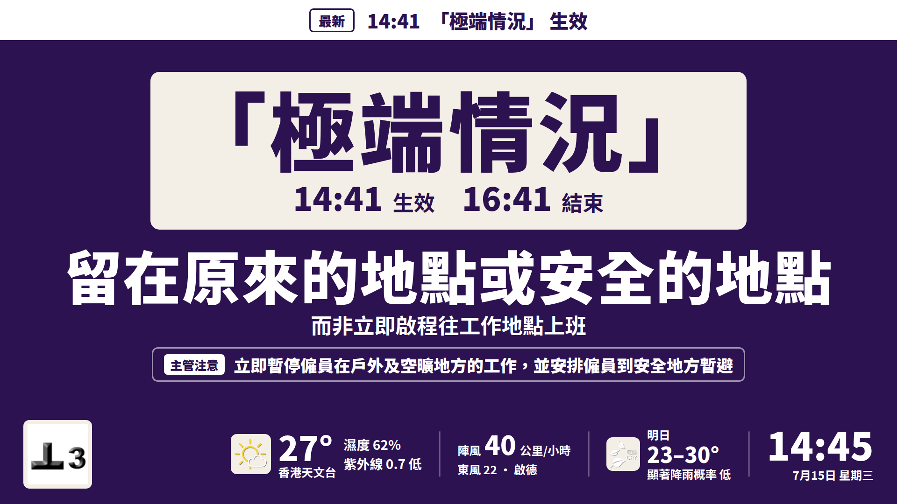
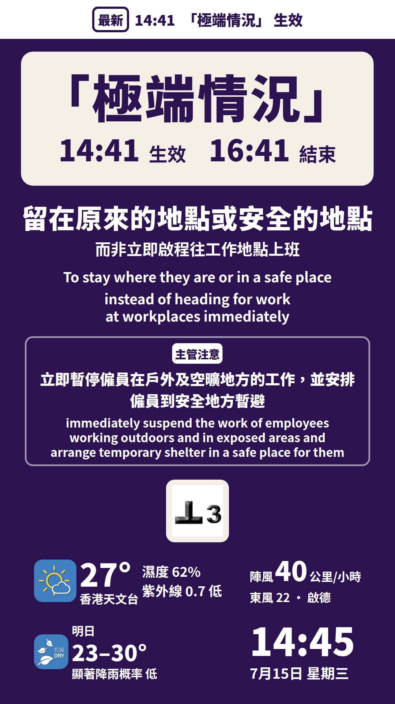

# 「極端情況」 (extreme conditions): design

Date: 2026-11-07. Builds on `2026-10-06-gate-screen-upgrade-design.md` (the main spec) and `2026-11-07-site-ready-upgrade-design.md`, where this was listed as a follow-up. Operator guide: `docs/site-setup.md` §9.

## 1. Goal

When the Government announces 「極端情況」, every gate screen shows it, with the Labour Department's own instruction for it, from the announced start to the announced end. An operator switches it on and off, because no official feed exists.

Without this, the screens would say 正常工作 during 「極端情況」 as soon as HKO lowers its signals. That is exactly when the Government is telling people to stay where they are.

## 2. Non-goals

- Detecting 「極端情況」 automatically. HKO publishes no open-data feed for it, and it is not an HKO warning.
- Per-site switching. The announcement applies to the whole territory, so one switch covers every site on the server.
- An admin web page. The switch is three HTTP calls, documented with copy-paste commands (§4.4).
- What the screen shows after 「極端情況」 ends. That is the same gap as after Signal 8 or Black rain (§11).

## 3. Official source and wording

**Source.** Labour Department 《惡劣天氣及「極端情況」下工作守則》, May 2026 (the back cover), source `ld-cop-weather` in `config/display_actions.json`.

- Re-downloaded on 2026-11-07 from https://www.labour.gov.hk/tc/public/pdf/wcp/Rainstorm.pdf: 7,557,313 bytes, sha256 `11d8c7f2a921ee59328edb8afbcf8488b52f0819cfd77b2a5d0f673a808e077d`, Last-Modified 5 Jun 2026. That is identical to `config/official_sources_lock.json`, so the PDF has not changed since the 2026-10-06 verification and the lock stays as it is.
- The cover and §1 give the title as 《惡劣天氣及「極端情況」下工作守則》, without 的. `sources.ld-cop-weather.titleZh` and the README now match it. `checked` is now 2026-11-07.

**What 「極端情況」 is** (footnote 2). The Government may announce it, for the whole territory, when a super typhoon or another large-scale disaster continues to seriously affect people's ability to get back to work, or causes safety problems. Its examples are large-scale power cuts, windows falling from tall buildings into the streets, serious landslips, widespread flooding and serious disruption to public transport across districts. So it covers the aftermath, when HKO's signals may already be low or gone.

**Which part of the Code.** Construction sites are outdoor and open-area work, so the wording comes from **Appendix 2** 《在戶外及空曠地方的工作安排參考指引》, not the general Appendix 1. In Appendix 2, for 「一般人員」, the 「極端情況」 column:

- rows (a) (announced before working hours) and (c) (announced before, ending during working hours) say the arrangements are the same as the column to their left: Black rain or Signal 8 and above;
- row (b) (announced or in force during working hours, printed page 53) has three bullets of its own.

The screen uses the first two bullets of row (b), verbatim. The page images were checked, so each bullet's column is certain.

| Shown as | Text on screen | Quote (`ld-cop-weather`, App. 2, 「一般人員」 (b), 「極端情況」) |
|---|---|---|
| Main instruction | 留在原來的地點或安全的地點 | 在公布的指定期間留在原來的地點或安全的地點，而非立即啟程往工作地點上班。 (bullet 1) |
| Sub line | 而非立即啟程往工作地點上班 | the same sentence |
| Supervisor line (主管注意) | 立即暫停僱員在戶外及空曠地方的工作，並安排僱員到安全地方暫避 | 主管應立即暫停僱員在戶外及空曠地方的工作，並安排僱員到安全地方暫避。 (bullet 2) |

- **Bullet 1** is the one instruction that is particular to 「極端情況」: stay put for the announced period. It is addressed to everyone, so it is the main line. 在公布的指定期間 is what the notice's times show (§6.1).
- **Bullet 2** is addressed to supervisors (主管應…), so it goes in the 主管注意 line, the same treatment as the thunderstorm line (main spec §4.5). It also covers what Signal 3's, Amber rain's and the thunderstorm's lines would have said, so those give way to it.
- **Bullet 3**, 如工作地點有危險…離開工作地點或提早下班, is not shown. It is a conditional decision for the employer, and on a screen read at a glance it would contradict "stay where you are".

**Kept honest by the existing guards.**

- The wording lives in a new `extreme` section of `config/display_actions.json`, as `extreme.display` (main and sub) and `extreme.supervisor` (fragments). Each has its quote and a `where` note pointing at the bullet.
- `tests/test_display_actions.py` checks every fragment is a contiguous part of its quote. `fragment_errors` now runs one rule over a fixed list of sections, `SECTIONS`, and rejects a section it does not know. A future section can no longer skip the check silently.
- `scripts/check_official_sources.py` downloads the PDF every week and checks both new quotes, with the same `SECTIONS`. A test fails if the two lists ever differ, or if the config has a section neither checks.
- The name 「極端情況」 and the words 生效 and 結束 next to the times are interface text, like 發出 in the meta line. They are the Code's own: 「極端情況」生效期間 and 「極端情況」結束 both appear in it.

## 4. The switch

### 4.1 Choice: an admin endpoint, not a flag file

| | Admin endpoint (chosen) | Flag file on the server |
|---|---|---|
| Who can switch | Whoever holds the key, from any phone or laptop | Only someone with SSH to the server |
| At 3 am after a typhoon | One `curl` command | SSH, then hand-write JSON in an editor |
| A typo | Refused at once, with the reason (400) | Found only in the logs or `/api/v1/health`, after the screens failed to change |
| Attack surface | A public endpoint behind a 256-bit key (§8) | None beyond SSH |

The endpoint wins on the thing that matters, which is getting it right quickly under pressure. Its state is still a plain file on the server (§4.3), and a hand edit of that file is picked up too. So SSH remains a fallback, for example when the key has just been replaced.

### 4.2 API

All three calls need `Authorization: Bearer <ADMIN_KEY>` over https.

| Call | Does | Answer |
|---|---|---|
| `GET /api/v1/admin/extreme` | Nothing. Shows the switch, and is the way to test the key | `{"status": "off"}`, or the status with `startsAt`, `endsAt` and `setAt` |
| `PUT /api/v1/admin/extreme` with `{"startsAt": optional, "endsAt": required}` | Switches on, or changes the times (an extension) | The new state |
| `DELETE /api/v1/admin/extreme` | Switches off now | The state left |

- `status` is `off`, `scheduled` (the start is later), `active` or `ended`.
- **Times** are ISO 8601, Hong Kong time unless they carry an offset: `2026-11-07T19:00` or `2026-11-07 19:00`.
- **`startsAt`** may be left out. An announcement in force or still to come then keeps its start, so an extension, which sends only the new `endsAt`, keeps the time 「極端情況」 took effect and shows no second 生效 banner. Otherwise it starts now. A later start is kept, and the screens wait for it. An earlier one (entered late) is shown as the time it took effect.
- **Refused, with the reason (400):** no `endsAt`; a time without a date (`19:00`); a date without a time (`2026-11-08`, which would otherwise mean midnight); an end that has passed; an end not after the start; an end more than 24 hours ahead; a new start more than 24 hours ago; any other field. The 24-hour limits catch a wrong day. A long 「極端情況」 can still be extended past 24 hours, because its recorded start is kept.
- **Switching off.** If 「極端情況」 is in force, DELETE sets its end to now. The record stays, and screens show 「極端情況」 結束 for 10 minutes. If it has not started yet, DELETE withdraws it. If nothing is on, DELETE changes nothing.
- **Off by default.** Without `ADMIN_KEY`, every call answers 403 `admin-disabled`, and the screens never show 「極端情況」.

### 4.3 State, expiry and restarts

- **The file.** The state is one JSON file, `extreme.json` in `STATE_DIR`, holding `startsAt`, `endsAt` and `setAt`. docker-compose sets `STATE_DIR=/app/extreme-state` and mounts the named volume `extreme-state` there, so it survives restarts, rebuilds and redeploys. With no file, the switch is off. It is a volume of its own: supervisor alerts keep their state on `alert-state`, which the guide says may be deleted, and deleting that must never switch 「極端情況」 off.
- **Writes** go to a temporary file, then `fsync`, then an atomic rename, so a crash never leaves half a file. If the file cannot be saved, the call answers 503 and nothing changes.
- **Expiry needs no timer.** Every snapshot works out the status from the clock and the recorded times. So 「極端情況」 ends at the announced end even if the service restarted in between, and a connected screen shows the change within its 30-second poll.
- **The file is read again when it changes** (modification time and size). A file that cannot be read or makes no sense is never fatal. 「極端情況」 is then off, `extremeProblem` in `/api/v1/health` says why, and health answers 503, so the uptime monitor reports it. Docker's `/healthz` ignores it.
- **The volume is checked at start-up.** When an admin key is set, the service checks at start-up that it can write the state folder, and reports a problem in health straight away rather than during an emergency.
- **Every site.** The state is server-wide. Every `?site=`, an unknown one, and every position get the same 「極端情況」.

### 4.4 Who switches it, and how

- **Who.** The service operator: the person who holds the admin key, which is kept in Bitwarden. A site's staff do not switch it. They call the operator. One switch changes every site's screens, and the announcement is territory-wide anyway.
- **When.** Only to mirror a Government announcement of 「極端情況」, with its announced times. Never for a site emergency or anything else: the screen would quote the Code of Practice for an announcement that does not exist.
- **How.** Switch on with the announced end, extend by entering the new end, and switch off only if the Government ends it early. When the announcement gives the start as an event rather than a clock time, for example a signal being replaced, switch on when it happens. `docs/site-setup.md` §9 has the commands.

## 5. Ranking

**Decision: 「極端情況」 in force takes the centre over every HKO warning and over heat stress. Every warning in force keeps its official icon on the bar.**

The full order is now 「極端情況」 > TC10 > TC9 > WRAINB > TC8 > WL > WTMW > WTCPRE8 > WRAINR > heat stress > normal. `snapshot.build_snapshot` applies it, `state.py` documents it, and the legacy `priority` band is P0 with `headlineZh` 「極端情況」.

Why:

1. **It is the only order that keeps every warning visible.** HKO warnings have official icons and stay on the bar whatever wins the centre. 「極端情況」 has no icon, so if anything outranked it, it would vanish from the screen.
2. **It is a Government instruction for a period.** The Code puts it alongside Signal 8 and Black rain, and its own instruction is to stay put for the announced period.
3. **"Stay sheltered" outranks "leave" (main spec §4.2).** With Signal 8 or Pre-8, the screen would otherwise say 分批離開工作地點 while the Government says stay where you are. That is the same reasoning that puts Black rain above Signal 8.
4. **It is announced for the aftermath** (footnote 2), so in practice it meets low signals: Signal 3, Signal 1, Amber rain, the monsoon signal. Those normally leave the centre at 正常工作, which is the real danger.
5. **Signal 9 or 10 at the same time is unlikely, and harmless if it happens.** 留在原來的地點或安全的地點 does not contradict 切勿外出 or 切勿離開有遮蔽的地方, and the signal's icon stays on the bar.

| In force with 「極端情況」 | Centre | Bar | 主管注意 |
|---|---|---|---|
| Nothing | 「極端情況」 | — | its own line |
| Signal 1 or 3, Amber rain, thunderstorm, monsoon | 「極端情況」 | their icons | its own line replaces theirs |
| Signal 8, Pre-8, Red or Black rain, landslip, tsunami | 「極端情況」 | their icons | its own line |
| Signal 9 or 10 | 「極端情況」 | the icon | its own line |
| Heat stress | 「極端情況」 (no rest tiles) | the heat-stress icon | its own line |
| 「極端情況」 scheduled or ended | Whatever HKO and LD say | as usual | as usual |

**Banner.** 「極端情況」 生效 shows for 10 minutes after the start, and 「極端情況」 結束 for 10 minutes after the end. Both outrank every HKO event. That matters in a likely start, since 「極端情況」 covers the aftermath: Signal 8 replaced by Signal 3 in the same minute that 「極端情況」 takes effect. The start banner never appears before the start, unlike the heat-stress banner's 15-minute lead, because the centre only changes at the start. Stale data hides the banner, as before.

**Supervisor alerts.** They read the same snapshot as the screens (`_live_snapshot` in `main.py`), so an alert sent while 「極端情況」 is in force repeats its lines exactly as the screen shows them: the instruction, the sub line, the meta line with the times, and its 主管注意 line. Switching 「極端情況」 on or off sends no alert, because alerts follow only the heat stress warning and HKO's warnings (§11).

## 6. Screen

### 6.1 A text-only state

There is no official icon, and AGENTS.md forbids drawing one, so the screen has no symbol at all:

- **A notice in the icon's place.** It is a cream plate, the same colour as the official icon plates, carrying 「極端情況」 very large and the announced period under it: `14:41 生效　16:41 結束`. A time not on today's date carries the date: `11月8日 08:00 結束`.
- **Then the usual lines:** the main instruction, the sub line, and one 主管注意 line. The supervisor line's trigger label is hidden, because it would only repeat the plate.
- **Tone `extreme`:** deep violet `#2c1250` with white text, and the plate's text in the same violet. No HKO or LD warning uses violet, so it is never mistaken for one. It is also clearly not the idle clay colour.

| At 1920×1080 / 1080×1920 | Landscape | Portrait |
|---|---|---|
| 「極端情況」 | 17cqh = 184 px | min(13.5cqw, 9cqh) = 146 px |
| Times / 生效 結束 | 69 / 45 px | 84 / 54 px |
| Main instruction (13 characters) | min(11.5cqh, 88cqw ÷ 13) = 124 px | min(10cqh, 92cqw ÷ 13) = 76 px |
| Sub line / supervisor line | 45 / 36 px | 45 / 43 px (two lines) |

On a 43-inch screen (about 0.5 mm per pixel), the name is 91 mm tall in landscape and 72 mm in portrait. The instruction is 61 mm and 38 mm.

- **Hierarchy.** As in the icon states, the hero, here the plate, is the largest thing, and the instruction is the largest line of text.
- **Portrait.** The main instruction stays on one line, by the main spec's rule (§4.1), so it is the smallest of any state's instruction (76 px). Splitting it into 留在原來的地點 / 或安全的地點 would nearly double it, but needs a line-break field in the config. That is left as an option (§11).
- **Fit.** Nothing is scaled in either orientation, even with four warning icons (`extreme-stack`). The bar hides tomorrow's forecast and the humidity by its usual rule.

### 6.2 A screen that loses the network

A screen keeps its last snapshot when the network drops. To stop it presenting an ended 「極端情況」 as current, a live screen counts its snapshot as stale once the announced end has passed by a minute, on its server-corrected clock (`extremeOverdue`, `present.ts`). It then shows 資料過期 — 請以我的天文台為準, as it does after 10 minutes without data. A connected screen has a fresh snapshot within 30 s of the end, so the minute of grace never misfires. Preview cases are exempt.

### 6.3 Preview and gallery

There are four new cases, in a new gallery group 「極端情況」:

| Case | Shows |
|---|---|
| `extreme` | 「極端情況」 alone |
| `extreme-tc3` | a likely start: Signal 3 issued and 「極端情況」 in force from the same minute, with the 生效 banner |
| `extreme-stack` | with Signal 8, Black rain, landslip and Amber heat stress: the bar under load |
| `extreme-ended` | ended 3 minutes ago: normal state with Signal 1, and the 結束 banner |

The preview takes `?site=` as before, and `POST /api/v1/sim` never touches the real switch.

## 7. API changes

All additive. A kiosk deployed before this change shows the instruction, the sub line and the meta line `「極端情況」 · 14:41 生效 · 16:41 結束`, with no plate.

- `display.mode` can be `"extreme"`. `heroRel` is null, `tone` is `"extreme"`, and `action` / `actionSub` are filled in as for weather states.
- `extreme`: `{nameZh, startsAt, endsAt, startZh, endZh}` while in force, else null.
- `banner.code` can be `"EXTREME"`.
- `/api/v1/health`: `extreme` (the switch's state, as `GET /api/v1/admin/extreme` reports it) and `extremeProblem`. Health answers 503 when the state cannot be read or saved.

## 8. Security

- **The key.** `ADMIN_KEY` holds at least 32 characters, generated randomly (`secrets.token_urlsafe(32)` gives 43). It is kept in Bitwarden (suggested key `HK_SITE_DISPLAY_ADMIN_KEY`) and in the server's untracked `.env`, which docker-compose reads. A shorter key turns the switch off and logs why. The key is never in git, a URL, a log or an answer.
- **Constant-time comparison.** Both sides are hashed with SHA-256 and compared with `hmac.compare_digest`, so neither the content nor the length leaks through timing.
- **Header only.** The key is read only from `Authorization: Bearer …`. A key in the query string is ignored, because access logs keep the path.
- **https only.** Caddy sets `X-Forwarded-Proto` from the real connection and replaces whatever a client sends. A call over plain http (the `:80` site, `http://SERVER_IP`) is refused with 403 `https-required`, even with the right key. By then the key has crossed the network in clear, so the guide says to replace it. Calls made inside the Docker network carry no such header and are allowed.
- **Checked before anything else.** The key is checked before the body is read, so an unauthenticated caller learns nothing, not even whether its JSON was valid.
- **Logging.** Every change is logged with its times. A refused call is logged without the key.
- **No rate limit or lock-out, on purpose.** A 256-bit key cannot be guessed, and a lock-out would let anyone block the real operator during an emergency.
- **CORS.** The app allows any origin but no credentials. Authentication is by header, never by cookie, so another website cannot use a browser to switch it.
- **Limited reach.** The key can only set the two times. It cannot change wording, sites or anything else. If it leaks, replace it (Bitwarden, `.env`, `docker compose up -d ingest`). `/api/v1/health` always shows the switch's state.

## 9. Testing

- **pytest, 357 tests (101 new).**
  - Rules: start, end, defaults, time zones, every refusal (a date without a time among them), an extension keeping its start (also past 24 hours), expiry at the end.
  - The state file: a restart, a hand edit, a bad file of each kind, a failed save that changes nothing, an unwritable folder found at start-up, switching off while in force, before the start and when off.
  - The key: constant time on SHA-256 digests, short or missing keys.
  - The API: no key on the server; eight kinds of missing or wrong key, for GET, PUT and DELETE; the key in a URL; the key checked before the body; plain http; refused calls logged without the key; on for every site and position; scheduled; an extension, with both times or only the new end, keeping its start and its banner; off; expiry at the end; a restart; a failed save; health with a bad state file.
  - Ranking against TC10, TC9, TC8, Black rain, landslip, Signal 3, Signal 1, thunderstorm and heat stress. The HKO icons stay in `signals`, its own supervisor line replaces theirs, and position changes nothing.
  - Banners: start, end, the 10-minute edges, never ahead of time, never when stale, and outranking a simultaneous Signal 10 or Black rain event.
  - Wording: verbatim, three paraphrases rejected, an unknown section rejected, every section checked by both the test and the weekly check, and both quotes found in the PDF text as pypdf extracts it.
  - The preview cases, and a site's own preview.
- **Real Chrome** (Playwright with the system Chrome, run by hand):
  - All 48 preview cases at 1920×1080 and 1080×1920 (96 renders): nothing over the bar or under the banner, nothing off screen, no clipped warning icon, no console errors.
  - The live switch against the local service with live HKO data, at both sizes. The Strong Monsoon Signal was in force, so this was a real ranking case. Wrong key and no key give 401, plain http through the proxy 403, and `endsAt: "19:00"` 400. Switching on showed the notice, the wording and the banner, with the monsoon icon still on the bar and its supervisor line replaced. The state survived a restart of the service. Switching off gave the normal state with the 結束 banner, and the monsoon line back.
  - Offline after the end: with the last snapshot 3.5 minutes old and the end passed, the screen showed 資料過期.
  - The gallery shows the new group with no console errors.
- **Wording against the source:** `python3 scripts/check_official_sources.py` downloads all six sources again and checks every quote, including the two new ones, plus the lock.

## 10. Rollout

1. Generate a key and store it in Bitwarden as `HK_SITE_DISPLAY_ADMIN_KEY`.
2. On the server, add `ADMIN_KEY=…` to `~/hk-site-display/.env`, without echoing it (`docs/site-setup.md` §9).
3. Tag the running images (`pre-extreme`), then deploy ingest and web as before. The compose file changed (new variables and the `extreme-state` volume), so `up -d` recreates ingest with the volume. Caddy is unchanged.
4. Check `/api/v1/health`: `"extreme": {"status": "off"}` and `"extremeProblem": null`. Then run the authenticated GET from §9 of the guide, through the public `https://` address. It should answer `{"status": "off"}`. If it answers 403 `https-required`, the proxy in front of the server reaches it over plain http (with Cloudflare, SSL mode Flexible): set that to Full (strict), then replace the key, which has crossed the internet in clear.
5. Optionally, rehearse on the live screens with a scheduled announcement a few minutes ahead, then DELETE it before it starts. A withdrawn announcement leaves no banner.

## 11. Follow-ups

- **After 「極端情況」, Signal 8 or above, or Black rain ends.** The Code (Chapter 3) requires cranes, scaffolding, gondolas, electrical installations and similar equipment to be examined by a competent examiner or person before they are used again. The screen goes straight back to 正常工作. A supervisor line for some hours after the end would close that gap. How long is a product decision, so it is not in this change.
- **Two-line instruction in portrait** (§6.1), if portrait screens turn out to be read from further away.
- **English line**, using the official English Code of Practice's wording for the same bullets, under the same verbatim test.
- **An alert when the switch changes.** Supervisor alerts (`app/alerts.py`) send nothing when 「極端情況」 starts or ends. A message for it would use the banner's words, 「極端情況」 生效 and 「極端情況」 結束.
